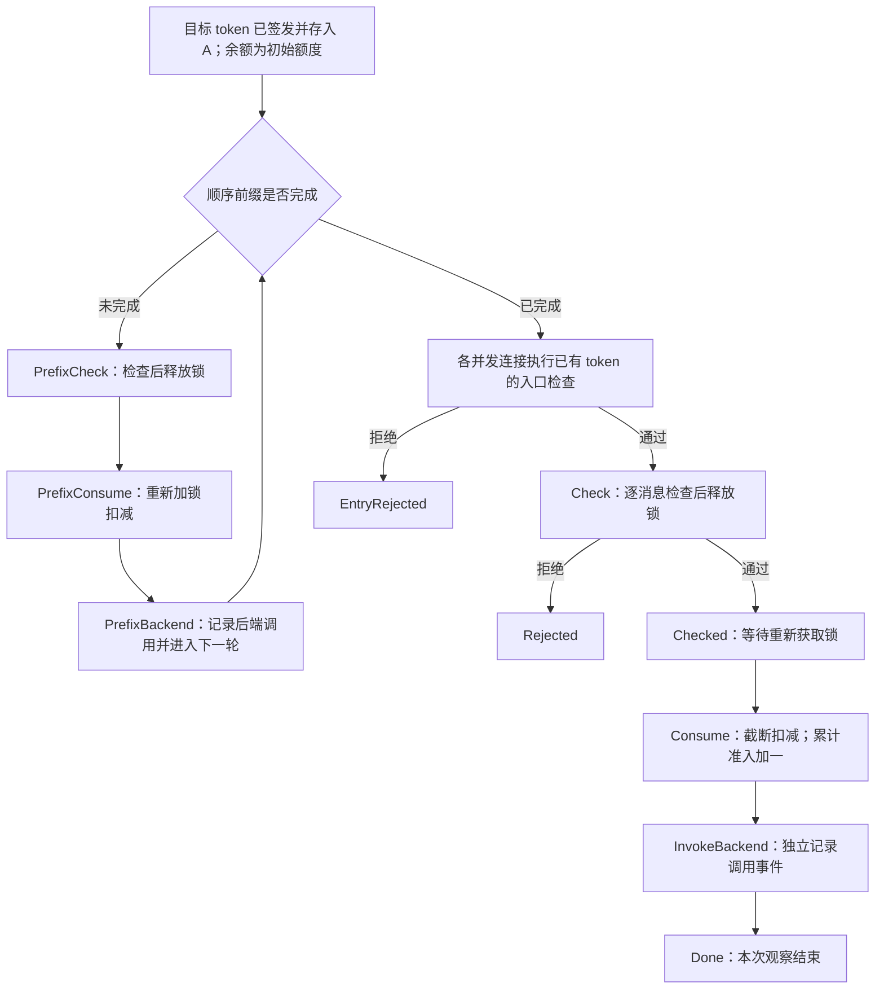

# SAGA 原版配额 TLA+ 模型

本目录把固定版本的接收侧配额流程人工抽象为可运行的 TLA+ 模型。主文件为 [SagaQuota.tla](SagaQuota.tla)，动作与源码的对应关系见 [SOURCE_MAPPING.md](SOURCE_MAPPING.md)。

模型保留原版的两个加锁区间：先检查，返回后释放锁，再获取锁扣减。`Consume` 没有新增余额检查。目录当前只包含原版模型，不包含修复版或原生代码补丁。

## 模型执行流程



图中的不同连接可以交错执行。`Check` 不预留额度；`Checked` 到 `Consume` 之间允许其他连接执行。锁内不涉及本次性质的细节被折叠，但没有将这两个区间合并。

## 常量与状态

| 项 | 含义 |
|---|---|
| `InitialQuota` | 本次 token 签发时的额度；固定常量 |
| `Connections` | 后续复用同一 token 的有限连接集合 |
| `PrefixUsed` | 在并发连接之前顺序执行的请求数量；模型从零累计，逐步执行这些请求 |
| `MetadataValid` | 固定的非配额条件：token 已知、未过期、PAC 匹配；本次配置全部为 TRUE |
| `remaining` | A 的共享剩余额度 |
| `accepted` | 完成扣减并进入后续处理的累计准入事件；新增观察计数 |
| `backendCalls` | 后端调用事件计数，与准入分开 |
| `pc[c]` | 每个并发连接的程序位置 |
| `checkedRemaining[c]` | 输出反例时辅助显示检查读数；不参与扣减决策 |
| `phase`、`prefixPC`、`prefixDone` | 明确执行顺序前缀所需的控制状态及已完成数 |

所有实例都从 `remaining = InitialQuota`、`accepted = 0` 开始。默认 50 的配置实际执行 49 次顺序检查、扣减和后端调用，然后允许两个新连接竞争最后一个额度；没有直接初始化成余额 1。

## 安全性质与查询

- `QuotaSafety`：`accepted <= InitialQuota`，是核心安全要求。
- `BackendQuotaSafety`：`backendCalls <= InitialQuota`，用于区分准入反例与后端调用反例。
- `TypeOK`、`SourceAccounting`：类型和观察计数一致性检查；它们成立不能代替配额安全。
- `NoAdmission`、`NoMessageRejection`：用于搜索可达性见证。它们被违反表示相应路径可达，不是新漏洞。

TLC 保持死锁检查开启。仅在合法终止状态加入 `TerminalStutter`；安全检查不增加公平性条件。

## 配置

下表是每个配置要检查的内容及预期用途，实际结果以 `evidence/<时间>/summary.json` 和原始日志为准。

| 配置名 | 初始额度／顺序前缀／并发连接数 | 用途 |
|---|---|---|
| `minimal_race` | 1／0／2 | 搜索最小准入超额反例 |
| `default_50_race` | 50／49／2 | 搜索默认配额下的准入超额反例，保留完整前缀 |
| `single_connection` | 1／0／1 | 单次请求的正常对照 |
| `exhausted_entry` | 1／1／2 | 顺序用尽后，复用 token 的新连接入口拒绝 |
| `zero_quota_entry` | 0／0／1 | 初始额度为零时，复用入口拒绝；不是“已建连接的消息级拒绝”场景 |
| `original_structure` | 1／0／2 | 遍历最小原版模型，仅检查结构计数，不检查配额安全 |
| `reachable_admission` | 1／0／1 | 故意检查 `NoAdmission`，取得合法准入可达的见证 |
| `reachable_message_rejection` | 1／0／2 | 故意检查 `NoMessageRejection`，取得消息级拒绝可达的见证 |
| `reachable_backend_overrun` | 1／0／2 | 单独搜索后端调用超额反例 |

## 运行

Windows PowerShell 中：

```powershell
Set-Location 'D:\Users\10202\Desktop\saga'
& '.\proofs\quota_validation\bootstrap.ps1'
& '.\proofs\consumer_validation\.runtime\venv\Scripts\python.exe' '.\proofs\quota_validation\run_tlc.py'
```

也可以使用能够运行标准库脚本的 Python 3。没有使用上述 venv 的第三方包。`bootstrap.ps1` 从官方发行来源下载并校验固定版本的 TLC 与便携 JRE，放在被忽略的 `.runtime/` 中；不修改系统 PATH。

已有 Java/TLC 时可以手动指定：

```powershell
python '.\proofs\quota_validation\run_tlc.py' --java 'C:\path\to\java.exe' --jar 'C:\path\to\tla2tools.jar'
```

运行指定配置：

```powershell
python '.\proofs\quota_validation\run_tlc.py' --cases minimal_race default_50_race
```

脚本先核对原生文件哈希与上游 Git blob，再检查 SANY 和各配置。每次新增独立时间目录，保存输入快照、命令、工具信息、源码哈希、标准输出、标准错误、状态图和结果 JSON。脚本整体退出 0 表示“各配置出现了其预期结果”，其中可能包含明确的安全性质违反，不能解读为原版通过验证。

官方来源：[TLA+ 工具说明](https://lamport.azurewebsites.net/tla/tools.html)、[TLC v1.7.4 发行页](https://github.com/tlaplus/tlaplus/releases/tag/v1.7.4)、[Adoptium JRE 元数据](https://api.adoptium.net/v3/assets/latest/21/hotspot?architecture=x64&image_type=jre&os=windows&vendor=eclipse)。实际下载 URL、校验值和 Java 版本保存在工具清单中。

## 结论边界

模型选择一个真实签发且已存储的 token；策略与身份验证通过，非配额元数据保持有效。B 可以控制自己的客户端，A 使用原生接收逻辑。后续每个并发连接只提交一条普通请求。顺序前缀采用普通消息和非终止响应，最多 100 次，使原生连接内查询上限不触发。

连接入口额度检查已展开，但 matcher、证书验证、TLS、网络收发、过期、token 删除、重启、多个 token 和 LLM 业务语义未展开。因此，这仍是有范围的状态模型，不是整个 SAGA 的完整实现模型。

TLC 反例属于该模型；原生代码的对应与重放是下一阶段的独立证据。本轮脚本不运行原生探针。有限配置检查通过也不能推出任意参数下的正确性。模型记录的后端调用不等于业务成功或响应交付。
